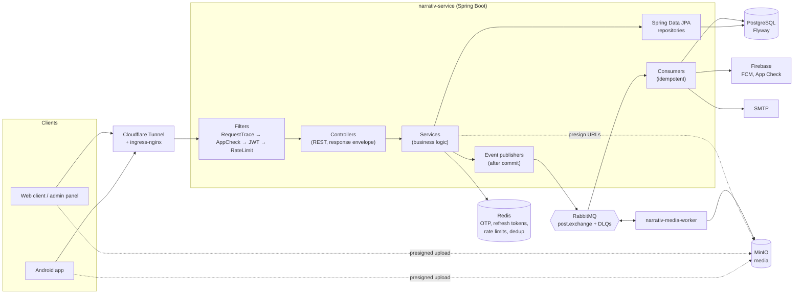

# NARRATIV Backend

Backend REST API for **NARRATIV**, a social storytelling app: users publish posts (text with up to 5 images/videos),
follow each other, like and comment, and receive push notifications. The same service also powers the web admin panel
(moderation, reports, metrics, broadcasts).

- Mobile clients authenticate with email/password or Google, protected by a JWT and (optionally) Firebase App Check.
- Media goes straight from the client to MinIO through presigned URLs; video thumbnails are made by a separate
  service, `narrativ-media-worker`, over RabbitMQ.
- Side effects such as pushes, emails and thumbnails run asynchronously over RabbitMQ, so a slow broker never fails
  an HTTP request.

> The source is public for review only. It is not open source: see [LICENSE](LICENSE).

**Related repositories:** [narrativ-android](https://github.com/rizkysiregar/narrativ-android) (the native Android
client) and [narrativ-media-worker](https://github.com/rizkysiregar/narrativ-media-worker) (video thumbnails).

---

## Tech stack

| Area           | Technology                                                               |
|----------------|--------------------------------------------------------------------------|
| Language       | Java 25                                                                  |
| Framework      | Spring Boot 4.0 (Web MVC, Data JPA, Security, Validation, Thymeleaf)     |
| Database       | PostgreSQL, schema managed by Flyway (`ddl-auto: validate`)              |
| Cache / limits | Redis (OTPs, refresh tokens, event deduplication, Bucket4j rate limits)  |
| Messaging      | RabbitMQ (topic exchange plus a dead-letter queue for every queue)       |
| Object storage | MinIO (S3 compatible), presigned upload and download URLs                |
| Push / auth    | Firebase Admin SDK (FCM, App Check), Google ID token verification        |
| Email          | Spring Mail (SMTP) with Thymeleaf HTML templates                         |
| API docs       | springdoc-openapi (Swagger UI)                                           |
| Observability  | Actuator, Micrometer Prometheus, Zipkin tracing, JSON logs (Logstash)    |
| Build / CI     | Maven wrapper, JaCoCo, OWASP Dependency-Check, Docker, Jenkins, Argo CD  |

## Features

### Mobile app (role `USER`)

- **Authentication**: register with an email OTP, log in with email/password or Google, refresh tokens, log out,
  forgot/reset password via OTP.
- **Account**: view and edit your profile, upload/replace/remove a profile image, delete your account (password
  confirmation).
- **Posts and feed**: create a post with up to 5 media (presigned upload URL per media), delete your own post, global
  feed, explore, following feed, a user's posts, open one post by id.
- **Social**: follow/unfollow, followers/following lists, follow status, like/unlike with like counts, comments and
  threaded replies. The author of a post can pin one comment on top, and a comment can quote part of the caption.
- **Safety**: block/unblock users (blocked users disappear from feeds, comments and notifications), report posts,
  comments or users.
- **Search**: search users and view public profiles.
- **Devices and notifications**: register/deactivate an FCM device token. You get a push when someone you follow
  posts, when someone likes or comments on your post, replies to your comment, follows you or pins your comment
  (email for replies if you have no active device).
- **Notification inbox**: the same events land in an in-app inbox, grouped ("ani and 3 others liked your post"), with
  an unread count and mark read / mark all read. Redelivered events never create a duplicate entry, and entries
  older than 90 days are cleaned up.
- **Legal pages**: public HTML privacy policy, terms and account deletion pages (EN/ID).

### Admin panel (role `ADMIN`)

- Dashboard metrics: overview and user/post growth by range.
- User management: search, detail, edit, ban/unban, force logout; list admins and register new admins.
- Content moderation: take down/restore posts and comments, hard-delete posts. The author is notified.
- Reports: list, detail, resolve (with an action) or dismiss.
- Notifications: broadcast pushes, broadcast history, manage notification templates.
- App parameters (key/value configuration) CRUD.
- Audit log of every admin action.

### Cross-cutting

- **Uniform response envelope** (`BaseResponse`: `code`, `message`, `data`, plus `errorCode`/`args` on errors),
  applied by `CustomResponseAdvise`; errors are mapped centrally in `RestErrorHandlerControllerAdviser`. The
  OpenAPI document shows the same envelope (`ResponseEnvelopeCustomizer`) plus an `ErrorResponse` schema, so clients
  can generate their types from `/v3/api-docs`.
- **Web client session**: a request with `X-Client-Platform: web` gets its refresh token as an HttpOnly,
  `SameSite=Strict` cookie scoped to `/api/v1/auth` instead of the `refreshToken` field (login, Google login,
  refresh, email change); `/auth/refresh` and `/auth/logout` then take no body. Mobile clients are unchanged
  (`WebSessionCookie`).
- **i18n**: messages in English and Indonesian, chosen from the `Accept-Language` header (`LocaleFilter`).
- **Rate limiting** per user (or per client IP for anonymous `/auth/**`), with separate buckets for feed, post
  creation, uploads, interactions and auth.
- **Firebase App Check** on mobile endpoints, in `off` / `log` / `enforce` mode.
- **Request tracing**: every request gets a trace id and a single access log line with a redacted body and the
  caller's `X-Client-Platform`/`X-App-Version` (`client=web/1.0.0`).
- **Scheduled jobs**: a casual-push broadcast every 8 hours (`FirebaseSchedulerService`), inbox retention
  (`NotificationRetentionJob`, 90 days by default) and an orphan media cleanup (`OrphanMediaCleanupService`, off by
  default, supports dry-run).

## Architecture



- **Synchronous path:** every request passes the servlet filters (trace id and access log, App Check, JWT, rate
  limit), then `controller` → `service` → `repository`. Responses are wrapped in one envelope (`BaseResponse`) and
  errors are mapped in one place.
- **Asynchronous path:** side effects (pushes, emails, inbox entries, thumbnails) are published to RabbitMQ only
  after the database transaction commits, so a rolled-back request never notifies anyone and a slow broker never
  fails a request. Consumers deduplicate redeliveries through Redis, and every queue has a dead-letter queue.
- **Media never passes through the service:** clients upload straight to MinIO with presigned URLs, and the
  service only stores object keys.

## API overview

All paths are under the context path `/api/v1` (port `9091` by default). Swagger UI is served at the root path in
`dev` / `local-dev` and disabled in `prod`.

| Group         | Endpoints                                                                                              |
|---------------|--------------------------------------------------------------------------------------------------------|
| Auth          | `POST /auth/register`, `/auth/register/otp`, `/auth/register/verify-otp`, `/auth/login`, `/auth/google`, `/auth/refresh`, `/auth/logout`, `/auth/forgot-password`, `/auth/verify-otp`, `/auth/reset-password`, `/auth/admin/login`, `/auth/register-admin` |
| Me            | `GET/PATCH /users/me`, `POST /users/me/profile-image/upload-url`, `PUT/DELETE /users/me/profile-image`, `POST /users/me/email/otp`, `POST /users/me/email`, `POST /users/me/deletion`, `GET /users/me/blocks` |
| Inbox         | `GET /users/me/notifications`, `GET /users/me/notifications/unread-count`, `POST /users/me/notifications/read`, `POST /users/me/notifications/read-all` |
| Users         | `GET /users`, `GET /users/by-username/{username}`, `GET /users/{userId}`, `POST/DELETE /users/{userId}/follow`, `GET /users/{userId}/followers`, `/following`, `/follow-status`, `POST/DELETE /users/{userId}/block` |
| Posts         | `GET /posts`, `/posts/explore`, `/posts/following`, `/posts/{postId}`, `/posts/users/{username}/posts`, `POST /posts/upload-url`, `POST /posts`, `DELETE /posts/{postId}` |
| Interactions  | `POST /posts/{postId}/like`, `DELETE /posts/{postId}/dislike`, `GET /posts/{postId}/likes/count`, `GET/POST /posts/{postId}/comments`, `PUT/DELETE /posts/{postId}/pinned-comment`, `DELETE /comments/{commentId}`, `GET /comments/{commentId}/replies` |
| Others        | `POST /reports`, `POST /devices`, `POST /devices/deactivate`, `GET /devices/web-push-config`, `GET /files/presign-url`, `GET /legal/{privacy-policy,terms,delete-account}` |
| Admin         | `/admin/users`, `/admin/admins`, `/admin/posts`, `/admin/comments`, `/admin/reports`, `/admin/metrics`, `/admin/notifications`, `/admin/notification-templates`, `/admin/parameters`, `/admin/audit-logs` |
| Actuator      | `/actuator/health`, `/info`, `/metrics`, `/prometheus` (separate port when `MANAGEMENT_SERVER_PORT` is set) |

The feeds (`GET /posts`, `/posts/explore`, `/posts/following`, `/posts/users/{username}/posts`) page with `page` or,
preferably, with `cursor`: every page answers `nextCursor` (absent on the last page), and passing it back returns the
posts after it without duplicates when new posts arrive while scrolling. Each post carries the author's
`profileImageUrl`.

- **Home** (`GET /posts`, `/posts/following`) shows your own posts and those of the people you follow, newest first.
  When they run out, the feed goes on with suggestions (ranked posts of people you do not follow), marked
  `"suggested": true`, so a new account does not start on an empty screen.
- **Explore** (`/posts/explore`) shows every post you may see except taken down ones, so it is only empty when there
  is nothing to show. The posts of the last 7 days come first, ranked by
  `(likes + 2 x comments + 1) / (age in hours + 2)^1.5 / (1 + open reports)`, with posts of people you follow
  multiplied by 0.5 and your own by 0.2 (new faces first), and at most 2 posts of one author in every 10. Older posts
  follow by date. The ranking of a scroll is kept in Redis for 30 minutes, so the order does not
  shift between its pages; without Redis explore is by date only.
- The weights are app parameters under `feed.ranking.*` (seeded by V15 and V16) and can be tuned from App management without
  a deploy.

The email of an account changes in two steps: `POST /users/me/email/otp` mails an OTP to the new address, then
`POST /users/me/email` with that OTP and the current password (or a Google id token) changes it, ends the other
sessions and answers a new token pair.

Authenticated endpoints expect `Authorization: Bearer <access token>`; mobile endpoints may also need the
`X-Firebase-AppCheck` header depending on the App Check mode.

## Asynchronous messaging

All events go through the `post.exchange` topic exchange. Every queue has a matching DLQ on `dlx.exchange`, and
consumers deduplicate redeliveries through Redis (`EventDeduplicator`).

| Routing key                 | Queue                            | Consumer                       | Effect                                            |
|-----------------------------|----------------------------------|--------------------------------|---------------------------------------------------|
| `post.created`              | `notification.queue`             | `NotificationConsumer`         | Push to the author's followers (skips blocks)     |
| `post.created`              | `email.queue`                    | `EmailConsumer`                | "Your post status" email to the author            |
| `post.liked`                | `post.liked.queue`               | `PostLikeConsumer`             | Inbox entry + "X liked your post" push, at most once per liker |
| `comment.replied`           | `comment.reply.queue`            | `CommentReplyConsumer`         | Inbox entry + push/email to the replied-to user and post owner |
| `activity.created`          | `activity.queue`                 | `ActivityConsumer`             | Inbox entry + push for a new follower or a pinned comment |
| `video.thumbnail.requested` | `video.thumbnail.request.queue`  | `narrativ-media-worker` (ext.) | Generates a thumbnail for an uploaded video       |
| `video.thumbnail.generated` | `video.thumbnail.result.queue`   | `VideoThumbnailResultConsumer` | Stores the thumbnail key on the post media        |

## Project structure

```
narrativ-backend/
├── src/main/java/com/rizkysiregar/narrativ/
│   ├── NarrativApplication.java
│   ├── adviser/        # response envelope wrapping and global exception handling
│   ├── annotation/     # @IgnoreResponseBinding (opt out of the envelope)
│   ├── config/         # Security, App Check, RabbitMQ, Redis, MinIO, Swagger, Jackson, async, WebClient
│   ├── constant/       # constants, whitelists, GlobalMessage (codes and error keys)
│   ├── controller/     # REST controllers (Admin* controllers serve the admin panel)
│   ├── exception/      # BusinessException
│   ├── filter/         # RequestTrace -> AppCheck -> Jwt -> RateLimit servlet filters
│   ├── i18n/           # locale resolution and localized messages
│   ├── messaging/      # event payloads, publishers, consumers, idempotency
│   ├── model/          # entity, dto, request (incl. custom constraints), response, enums
│   ├── repository/     # Spring Data JPA repositories
│   ├── service/        # business logic; sub-packages appcheck, auth, email, firebase, otp, ratelimit, impl
│   └── util/           # helpers (paging, Redis, IP resolution, masking, after-commit hooks, ...)
├── src/main/resources/
│   ├── application.yml              # shared config, every value read from env vars
│   ├── application-{local-dev,dev,prod}.yml
│   ├── db/migration/                # Flyway migrations V1..V18
│   ├── i18n/messages*.properties    # EN (default) and ID messages
│   ├── legal/                       # privacy policy, terms, delete-account pages (EN/ID)
│   ├── templates/email/             # OTP, comment reply and post status emails
│   └── logback-spring.xml
├── src/test/java/...                # unit and slice tests (JUnit 5, Mockito, AssertJ)
├── deploy/                          # *.secrets.env.example for dev/prod Kubernetes secrets
├── docs/                            # deployment and CI guides (see below)
├── Dockerfile                       # layered JRE image, non-root user 10001
└── Jenkinsfile                      # CI + GitOps pipeline
```

Request flow: `controller` → `service` → `repository`; side effects are published after commit by
`messaging/publisher` and handled by `messaging/consumer`.

## Getting started

### Prerequisites

- JDK 25
- Maven 3.9+ (or the bundled `./mvnw`)
- Access to PostgreSQL, Redis, RabbitMQ and MinIO (the shared development infrastructure, or your own)
- A Firebase service account key for push notifications (optional locally)

### 1. Clone

```shell
git clone https://github.com/rizkysiregar/narrativ-backend.git
cd narrativ-backend
```

### 1b. Run fully local (recommended for day-to-day work)

`docker-compose.yml` runs PostgreSQL, Redis, RabbitMQ, MinIO and Mailpit on your machine, apart from the shared dev
environment (own database, vhost and bucket; emails land in Mailpit instead of real mailboxes).

```shell
docker compose up -d
cp .env.local.example .env.local     # set FIREBASE_CREDENTIALS_FILE and SECRET_KEY (openssl rand -base64 64)
./mvnw spring-boot:run               # profile "local"
```

`.env.local` is read after `.env` and wins over it; remove it to run against the dev infrastructure again (step 2).
`docker compose down -v` wipes all local data. UIs: RabbitMQ http://localhost:15672, MinIO http://localhost:9001,
Mailpit http://localhost:8025 (credentials in `docker-compose.yml`).

### 2. Configure the environment

```shell
cp .env.example .env
```

Fill in the empty values (database, Redis, RabbitMQ, mail, MinIO, `SECRET_KEY`, `GOOGLE_CLIENT_ID`, ...).
`application.yml` imports `./.env` automatically, so no extra export is needed. `.env` is git-ignored; never commit it.

Important variables:

| Variable                                       | Purpose                                                          |
|------------------------------------------------|------------------------------------------------------------------|
| `SPRING_PROFILES_ACTIVE`                       | `local-dev` (laptop to dev infra), `dev` or `prod` (Kubernetes)  |
| `DEV_INFRA_HOST`                               | Host of the dev PostgreSQL / Redis / RabbitMQ in `local-dev`     |
| `SECRET_KEY`                                   | JWT signing key                                                  |
| `FIREBASE_CREDENTIALS_FILE` / `_JSON`          | Firebase service account (file wins when both are set)           |
| `APP_APPCHECK_MODE`, `APP_APPCHECK_PROJECT_NUMBER` | App Check mode (`off` locally) and Firebase project number   |
| `APP_RATE_LIMIT_*`                             | Requests per minute for each bucket                              |
| `APP_STORAGE_ORPHAN_CLEANUP_ENABLED` / `_DRY_RUN` | Orphan media cleanup switch and dry-run                       |
| `APP_CORS_ALLOWED_ORIGINS`                     | Comma separated origins for deployed environments                |
| `LEGAL_CONTACT_EMAIL`                          | Contact on the legal pages; `prod` refuses to start without it   |
| `APP_LOGGING_REQUEST_BODY`                     | `ALWAYS` / `ERRORS` (default) / `NEVER` for request bodies in the access log|

### 3. Run

```shell
./mvnw spring-boot:run
```

The API is then available at `http://localhost:9091/api/v1`, with Swagger UI at the same address.

### Database migrations

Flyway runs on startup from `src/main/resources/db/migration`. Add a new file `V<next>__<description>.sql`; never
edit a migration that has already been applied. Hibernate only validates the schema.

## Development workflow

Run the tests before pushing:

```shell
./mvnw test
```

For a full check before merging into `master`, `verify` also writes the JaCoCo coverage report
(`target/site/jacoco/index.html`) and runs the OWASP dependency vulnerability check:

```shell
./mvnw clean verify
```

Work on a `feature/*` branch and merge through a pull request. Commits follow Conventional Commits
(`feat(post): ...`, `fix(auth): ...`).

## Deployment

Deployment is fully automated; nobody builds or pushes images by hand. A merge to `master` is the release.

```text
merge to master
  → GitHub webhook → Jenkins (Jenkinsfile)
      test → package → build & push ghcr.io/rizkysiregar/narrativ-service:<sha>
      → commit the new tag to homelabs-gitops
  → Argo CD sees the GitOps commit and rolls it out to the RKE2 cluster
```

### CI/CD (Jenkins + GitOps)

The `Jenkinsfile` pipeline, triggered by the GitHub webhook on every push to `master`:

1. **Checkout** and tag the build with the 12-character commit SHA.
2. **Test**: `mvn clean test` in a `maven:3.9-eclipse-temurin-25` container. A failing test stops the release.
3. **Package** the JAR.
4. **Build and Push Image** `ghcr.io/rizkysiregar/narrativ-service:<sha>` (linux/amd64).
5. **Update GitOps Image Tag**: sets `newTag` in `apps/narrativ-dev/kustomization.yaml` of the GitOps repository and
   pushes a `deploy(narrativ-dev): <sha>` commit.

Argo CD then reconciles the new desired state. Jenkins has no Kubernetes credentials and never runs `kubectl`.
Rolling back means changing `newTag` back to an earlier SHA in the GitOps repository.

### GitOps repository

Kubernetes manifests live in a separate, private GitOps repository (`homelabs-gitops`), not in this repository:

| Path                 | Content                                                                            |
|----------------------|------------------------------------------------------------------------------------|
| `apps/narrativ-dev`  | Dev: backend + media worker, ConfigMap, Service, Ingress (tag updated by Jenkins)  |
| `apps/narrativ`      | Prod: same resources, tags promoted manually                                       |
| `apps/monitoring`    | Grafana Alloy DaemonSet: pod logs to Loki, metrics to VictoriaMetrics              |

Credentials are not in Git: they are Kubernetes Secrets created by the cluster operator (see
[`docs/deployment-secrets.md`](docs/deployment-secrets.md)).

### Docker image

The image is built by Jenkins from the `Dockerfile`, which copies the JAR from the Package stage: it runs on
`eclipse-temurin:25-jre-alpine` as non-root user `10001`, exposes `9091` and reads its config from `/app/config/`.

### Further documentation

| Document                                                                 | Topic                                          |
|--------------------------------------------------------------------------|------------------------------------------------|
| [`docs/jenkins-pipeline-setup.md`](docs/jenkins-pipeline-setup.md)       | Jenkins agent and credentials setup            |
| [`docs/rke2-gitops-deployment-guide.md`](docs/rke2-gitops-deployment-guide.md) | One-time RKE2 + Argo CD + Cloudflare setup |
| [`docs/deployment-secrets.md`](docs/deployment-secrets.md)               | How secrets and config reach the pods          |

## Security notes

- **No secrets in the repository.** Every credential (database, Redis, RabbitMQ, mail, MinIO, JWT key, Firebase
  service account) is read from environment variables. Locally they come from a git-ignored `.env`, and in Kubernetes
  from Secrets created by the cluster operator. `.env.example` and `deploy/*.secrets.env.example` only list the
  names.
- **Authentication:** JWT access tokens valid for 15 minutes, with single-use (rotated) refresh tokens stored hashed
  in Redis. Admin endpoints and the actuator need the `ADMIN` role. Passwords are hashed with BCrypt (cost 12).
- **Abuse protection:** Firebase App Check on mobile endpoints (`off` / `log` / `enforce`), per-user rate limits, a
  per-IP limit on anonymous `/auth/**` calls (login, register, OTP), and a strict 15-minute bucket for
  password-confirmed actions such as account deletion and email change.
- **Privacy in logs:** request bodies are logged with `password`, `token` and similar fields redacted, only for
  failed requests by default, and sensitive DTO fields are excluded from `toString()`.
- **Production hardening:** Swagger UI and the OpenAPI document are disabled, email verification is enforced, the
  service refuses to start without a legal contact address, and the container runs as a non-root user.
- **Dependencies:** `./mvnw verify` runs the OWASP Dependency-Check.

## License

Copyright (c) 2024-2026 Habib Rizky Almajid Siregar. All rights reserved. The code is public for review only; see
[LICENSE](LICENSE).
